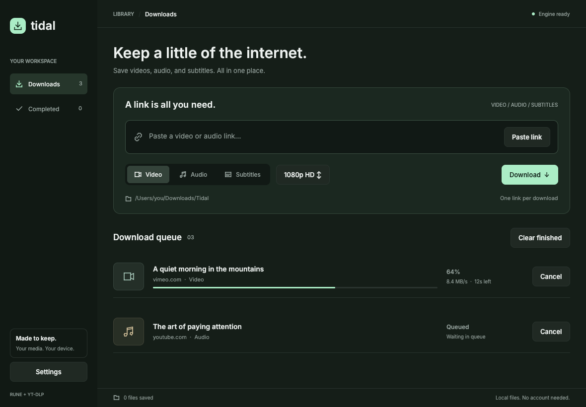

# emul

A native media downloader built with [Rune](https://github.com/anomalyco/rune) and [yt-dlp](https://github.com/yt-dlp/yt-dlp), inspired by ID4's focused download workflow. Rust renders the entire interface; there is no webview or local web server.



## Download

Version-tagged GitHub Releases contain complete bundles for both **x86-64**
(`x86_64`) and **ARM64 / Apple Silicon** (`aarch64`):

| Platform | Release downloads | Launch |
| --- | --- | --- |
| Linux | `.AppImage`, `.tar.gz` | Execute the AppImage or extracted `emul` launcher |
| macOS | `.dmg`, `.tar.gz` | Open `emul.app`; copy it to Applications to install |
| Windows | `.zip`, `.tar.gz` | Extract the folder and run `emul.exe` |

Every bundle includes yt-dlp (with Python and EJS), FFmpeg, ffprobe, and Deno.
Users do not install these tools separately. The app finds its packaged tools
without relying on the user's PATH. Updating the bundle updates the media tools.
Keep extracted folders together, including their tools and libraries.

Linux releases target glibc 2.39+ (Ubuntu 24.04 or equivalent) and require a
working Vulkan driver. macOS releases target macOS 14+, on Intel or Apple Silicon.
Windows releases target x64 Windows 10+ and ARM64 Windows 11, with Direct3D 12
support. The release matrix covers these six native OS/CPU combinations; 32-bit,
ARMv7, RISC-V, and other architectures are not supported by the complete stack.
macOS packages are ad-hoc signed, without Apple notarization. Windows binaries
are unsigned; certificate-based signing is not configured.

For example, on x86-64 Linux:

```sh
chmod +x emul-0.1.0-x86_64.AppImage
./emul-0.1.0-x86_64.AppImage
# Or use the executable archive, without FUSE:
tar -xzf emul-0.1.0-linux-x86_64.tar.gz
./emul-0.1.0-linux-x86_64/emul
```

If FUSE is unavailable, the AppImage also supports `APPIMAGE_EXTRACT_AND_RUN=1`.
Append `--check-tools` to the app executable or launcher to check bundled tools.
All runnable downloads have SHA-256 sidecars. The separate `media-sources`
archive contains source code and build recipes, not the runnable application.

## Run from source

Install Rust, yt-dlp, and FFmpeg. Install Deno for YouTube JavaScript challenges
(see [yt-dlp’s runtime setup](https://github.com/yt-dlp/yt-dlp/wiki/EJS)). Make sure `yt-dlp` and `ffmpeg` are available on PATH **when launching the app**.

```sh
# From the project root
cargo run
# Optimized standalone executable
cargo build --release --locked
```

The executable is `target/release/emul` (`.exe` on Windows). Rune is pre-release and pinned to commit `dece2aff3a254ffd6f6a0a49baa82b75664b3190` for reproducible dependency resolution.

Linux also needs `libxkbcommon` and `libwayland-client` development libraries to build, and a Vulkan driver to render. On Ubuntu/Debian:

```sh
sudo apt-get install libxkbcommon-dev libwayland-dev libxkbcommon-x11-0 mesa-vulkan-drivers
```

On macOS, install Xcode Command Line Tools; Homebrew provides yt-dlp and FFmpeg. On Windows, install the Rust MSVC toolchain and Visual Studio C++ Build Tools; install yt-dlp and FFmpeg and add them to PATH. An installed GPU driver is required. The release workflow builds both native CPU architectures on Linux, macOS, and Windows. Only Linux x86-64 has been exercised locally; the other builds must pass their native GitHub runner checks before publication.

## Use

1. Paste a complete HTTP(S) link, or use **Paste link**.
2. Select **Video**, **Audio**, or **Subtitles**.
3. Click the video quality control to cycle **1080p → 4K → Best available → 720p**. Quality is an upper bound; the source determines available formats.
4. Click **Download** or press Enter in the URL field.

Video preserves source codecs; split streams merge into MKV, while a single stream can retain its original container. Audio extracts to MP3 at yt-dlp's best encoding quality. Subtitles download English manual or automatic tracks as SRT when available; an absent track is reported as an error. This version saves one item per link; it does not expand playlists.

The queue runs one download at a time, oldest first. Cancel stops yt-dlp and its FFmpeg child processes; partial files stay in the destination so **Retry** can resume where yt-dlp supports it. Completed files appear under **Completed**, with **Open folder**. **Clear finished** clears completed, failed, and cancelled history entries; it leaves downloaded files on disk.

Settings accepts an absolute destination path. It creates the folder on save and applies changes to future jobs. Defaults to `Downloads/emul`. History and the selected folder live in the platform's local application data directory under `emul/`. Closing the app cancels running work; interrupted entries offer Retry on the next launch. No accounts, analytics, or cloud persistence. Media providers receive ordinary yt-dlp network requests.

## Build and publish releases

Build on the native OS and CPU architecture. Packaging validates executable
headers, including universal macOS tools, to reject mismatched binaries.

On Linux, install Python 3.12+, Rust, a C compiler, make, curl, pkg-config,
patchelf, and the Linux libraries listed above (also `libfontconfig1`, `libx11-6`,
`libxcursor1`, `libxrandr2`, and `libxi6`). Run:

```sh
python3 scripts/build-appimage.py
```

On macOS, install Python 3.12+, Rust, Xcode Command Line Tools, and pkg-config,
then run `python3 scripts/build-native.py`. On Windows, use the MSVC Rust
toolchain and Python with MSYS2 UCRT64 (x64) or CLANGARM64 (ARM64) for the
FFmpeg/LAME source build. The workflow runs `--prepare-media`, the MSYS2 build
recipe, and `--finish-media` before `python scripts/build-native.py`; see the
[complete native build steps](.github/workflows/release.yml).

Dependencies use pinned, SHA-256-verified downloads. FFmpeg and its MP3 encoder
are built from the same source archives on every platform. Linux desktop
libraries are gathered with linuxdeploy. Artifacts and checksum files go to
`dist/`. Build caches live under `target/appimage*` and `target/bundles/`.
Build Linux releases on Ubuntu 24.04 for the documented glibc baseline; a newer
build host can raise the minimum glibc requirement.

The `Desktop builds and releases` workflow builds and verifies all six matrix
entries on branch pushes, pull requests, and manual runs. Only a pushed `v*` tag
matching `Cargo.toml` (such as `v0.1.0`) publishes a GitHub Release. Publication
waits for every matrix entry to pass, then attaches all platforms' tar archives,
Linux AppImages, macOS DMGs, Windows ZIPs, shared media sources, and checksums.
No signing credentials are required for the current unsigned/ad-hoc packages.
See [third-party components](packaging/THIRD-PARTY.md) for the source recipes.

## Verify

```sh
cargo test --locked
cargo clippy --locked --all-targets -- -D warnings
cargo run -- --snap /tmp/emul.png --scene showcase
```

The `showcase` scene uses illustrative queue content for design inspection only; it never downloads or saves history. Ordinary launches show your actual queue and history. Rune's built-in `--snap`, `--tree`, and `--script` tools render and drive the native interface headlessly without a display.

Tests exercise URL validation, shell-free argument construction, progress decoding, history recovery, format selection, queueing, cancellation, retry, and navigation. An optional real worker test generates a short fixture with FFmpeg, serves it locally, and verifies video, MP3, SRT conversion, missing-subtitle errors, and process cancellation:

```sh
python3 tests/smoke.py
# After building release packages on the native host:
python3 scripts/verify-bundle.py
```

Use media you own or have permission to download. Availability and provider authentication restrictions are determined by yt-dlp. Cookie management, playlist expansion, built-in dependency installation for source builds, signed installers, automatic updates, and mobile targets are not included.
